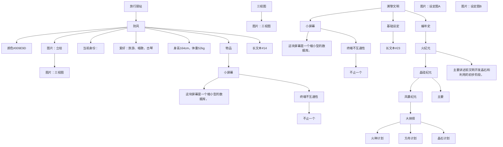

# 《旅行驿站》脑图大纲

> 源文件：`旅行驿站.prg`　快照：2026-11-05 21:30:39　sha256：`b89097a82ae7`
> 节点 60 个（文本 26 / 图片 4 / 连线 28 条）
> 层级＝弧线方向；同级顺序＝文件内创建顺序（约等于作画顺序）。

## 一、结构大纲

- 旅行驿站
  - 防风
    - 颜色#009E9D
    - 【图片：立绘】
      - 【图片：三视图】
    - 当前身份：
    - 爱好：旅游、唱歌、古琴
    - 身高164cm，体重52kg
    - 物品
      - 小屏幕
        - 这块屏幕是一个缩小型的数据库，
        - 终端不互通性
          - 不止一个
    - 背景：这一切都要追溯到防风胸口上挂的那一块小屏幕说起。  `[长文本，全文见附录 14]`
- 三视图
  - 【图片：三视图】
- 溯黎文明
  - 小屏幕
    - 这块屏幕是一个缩小型的数据库，
    - 终端不互通性
      - 不止一个
  - 基础设定
    - 亿万年前的一个人类文明，当时这个星系的核心也有一个太阳，那个文明的人将他…  `[长文本，全文见附录 23]`
  - 编年史
    - 火纪元
      - 晶硅纪元
        - 风暴纪元
          - 大抉择
            - 火种计划
            - 方舟计划
            - 晶石计划
        - 主要
      - 主要讲述前文明开发晶石和利用的初步阶段，
- 【图片：设定图A】
- 【图片：设定图B】

## 二、Mermaid 流程图

## 三、附录：长文本全文

### 附录 14

背景：这一切都要追溯到防风胸口上挂的那一块小屏幕说起。
与其说是偶然中捡到的，倒不如是这块屏幕选择了她。没人能查清这块屏幕的来历，这块屏幕是一个缩小型的数据库，
而这个数据库保存的是亿万年前的一个人类文明，人们把这个文明命名为“溯黎”。
这个文明所居住的星球在亿万年前所处的位置便是地球所处的轨道，根据数据库中的信息，
当时这个星系的核心也有一个太阳，那个文明的人将他们的太阳命名为“蚀”。那个文明所居住的星球被命名为“洄”。
有很多个星球都绕着“蚀”有规律的行驶在自己的轨道上。
据数据库显示，“洄”上的人类文明发展了很久很久，其技术已经远超我们所处的地球文明。
但正如太阳在不断膨胀一样，“蚀”也在不断膨胀，它的存在孕育了第一次宇宙大爆炸，我们现在所处的银河系便是这场宇宙大爆炸的产物。
没有人知道那个被命名为“溯黎”的文明是否存活，逃离？
亦或是灭亡。我们只知道，他们留下了这么一块屏幕，里面存着一个数据库，是独属于他们那个文明的年轮。

这块屏幕与防风：防风是怎么遇到它的呢？那是一个月黑风高的晚上，防风为了看一场流星雨，来到了可以看流星雨的山头，在山上安扎了帐篷，
看完流星雨后，她便睡下了。她做了一个梦，在梦中，她身处于一个她完全陌生的十字路口。
人们穿着奇异的衣服，人们簇拥着奔向不同的路口，四个路口的尽头，她也不记得是什么了，
她印象中，好像隐隐约约往东边的路口的尽头是一座在雾中若隐若现的巨型的太空飞船。
她想抓住人群中的某个人询问情况，可她不清楚她是虚影，还是这群人是虚影，她的身体穿过的那些人群，人们似乎并未看到她的存在。
醒来时，她发现枕边出现了一块闪着蓝紫色交织的光的小屏幕。
当她用手拿起这块屏幕时，这块小屏幕仅在分秒内就完成了与她的基因绑定。
她也因此成为了进入这个数据库的唯一存在，成为了这个古老的、先进的文明的唯一探索者。

为什么这个文明选择了她？等待防风的未来又是什么呢？
我们无法看清，未来是一场永恒环绕着迷雾的森林，但似乎又在规律的进行着日升月落、花开花落，充斥着命运的定数。
但我们唯一可以确信的是，防风，已然开启了她的探索之旅。

### 附录 23

亿万年前的一个人类文明，当时这个星系的核心也有一个太阳，那个文明的人将他们的太阳命名为“蚀”。
那个文明所居住的星球被命名为“洄”。有很多个星球都绕着“蚀”有规律的行驶在自己的轨道上。
据数据库显示，“洄”上的人类文明发展了很久很久，其技术已经远超我们所处的地球文明。
但正如太阳在不断膨胀一样，“蚀”也在不断膨胀，它的存在孕育了第一次宇宙大爆炸，我们现在所处的银河系便是这场宇宙大爆炸的产物。
没有人知道那个被命名为“溯黎”的文明是否存活，逃离？亦或是灭亡。
我们只知道，他们留下了这么一块屏幕，里面存着一个数据库，是独属于他们那个文明的年轮。
